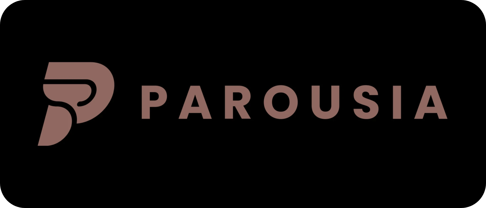

### **Your Rich Presence on Discord and beyond.**

## What is Parousia?

Parousia is an open-source Rich Presence platform. It shows what you're doing in your browser on Discord, and on other platforms as they're supported.

It has two parts: a browser extension and a small native desktop app. No account or sign-in is needed.

## Features

- **Rich Presence** for supported websites and web apps
- **Activities** from Parousia and PreMiD
- **Local only**: the browser talks to the desktop app over loopback
- **No account, no analytics, no telemetry**
- **Minimal permissions**: website access is requested only when an Activity needs it
- **Discord** through its official local RPC interface
- **Windows and Linux** desktop support, with macOS planned
- **A TypeScript API** for writing Activities
- **A lightweight desktop app** written in Rust

## Get Parousia

### Browser Extensions

| Browser  | Status    | Install                                                                                                |
| -------- | --------- | ------------------------------------------------------------------------------------------------------ |
| Chromium | Available | [Chrome Web Store](https://chromewebstore.google.com/detail/parousia/achhedhokopfgfnigkfchklhbebbhebd) |
| Firefox  | Available | [Mozilla Add-ons](https://addons.mozilla.org/en-US/firefox/addon/parousia/)                            |

### Desktop & Other Downloads

| Platform   | Status      | Download                                                   |
| ---------- | ----------- | ---------------------------------------------------------- |
| Windows    | Available   | [GitHub Releases](https://github.com/Abadima/RPC/releases) |
| Linux      | Available   | [GitHub Releases](https://github.com/Abadima/RPC/releases) |
| macOS      | Coming soon | Not yet                                                    |
| Userscript | Available   | [GitHub Releases](https://github.com/Abadima/RPC/releases) |

## Activity Ecosystem

Activities are maintained in their own repositories, and they all run on the Parousia's local runtime.

**[parousia-project/activities](https://github.com/parousia-project/activities)** - Runs under Parousia's native Activity API.

**[premid/activities](https://github.com/premid/activities)** - PreMiD's Activities, which runs under a compatibility layer in Parousia.

Each Activity covers a website. It sets its own settings, page data, site access, Discord application, and Rich Presence details.

Parousia includes the native Activities and a large set of compatible PreMiD Activities.

## Documentation

Installation, configuration, Activities, compatibility, privacy, security, and development are covered at **[parousia.abadima.dev](https://parousia.abadima.dev)**. The site is built from **[parousia-project/website](https://github.com/parousia-project/website)**.

## Roadmap

See [`project/roadmap.md`](project/roadmap.md) for the current roadmap.

## Technology

- **Desktop:** Rust
- **Browser & Activities:** TypeScript
- **Browser:** Chromium, Firefox, and userscript builds
- **Platforms:** Discord; Fluxer once it offers Rich Presence to other apps
- **Architecture:** Local browser-to-desktop WebSocket with native platform adapters

## Contributing

Issues, discussions, and pull requests are welcome. Start with [`CONTRIBUTING.md`](.github/CONTRIBUTING.md). Contributors are credited in [`CONTRIBUTORS.md`](CONTRIBUTORS.md).

Report security vulnerabilities privately, as described in [`SECURITY.md`](.github/SECURITY.md).

## License

Parousia is licensed under the [Apache License 2.0](LICENSE).

Third-party components keep their own licenses: PreMiD Activities are under the Mozilla Public License 2.0, the font under the SIL Open Font License, and the icons under CC BY 4.0. Each extension release includes `THIRD-PARTY-NOTICES.txt`. Desktop releases include `parousia-desktop-notices.txt`, which lists the statically linked Rust dependencies.
